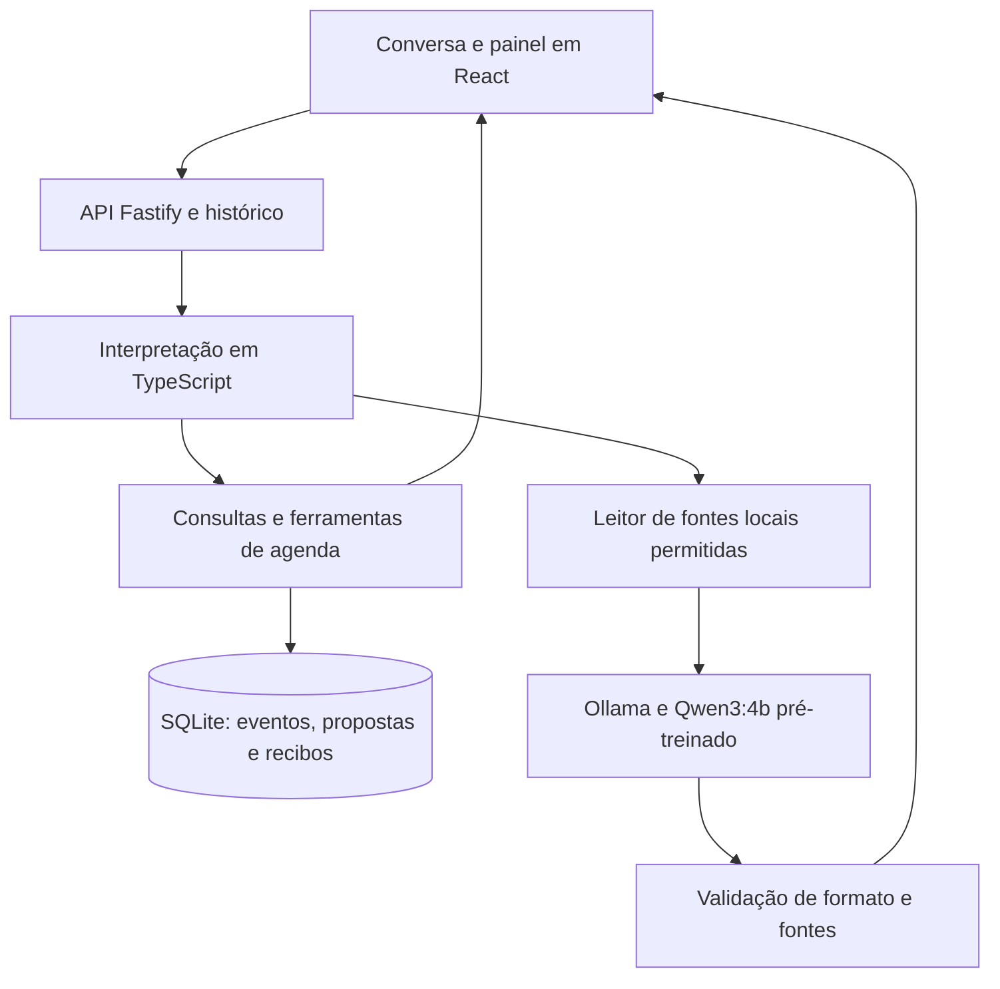

# Agente César 2.0: apresentação para portfólio

## Problema e proposta

Organizar compromissos por conversa exige consultar informações atuais, completar
dados ausentes e transformar o pedido em uma alteração verificável. Uma resposta
plausível do modelo, sozinha, não confirma que um compromisso foi registrado nem
que o horário está livre.

Este projeto explora um assistente local sobre uma agenda já existente. A
demonstração reúne painel do dia, tarefas, consulta de preferências, registro de
compromissos e planos semanais com confirmação e reversão. Usa somente dados
fictícios, com banco temporário separado.

## Arquitetura atual



As consultas de calendário e os planos semanais são interpretados por código.
O LLM responde a consultas com contexto selecionado; não escolhe caminhos de
arquivos e não recebe ferramentas de escrita. A recuperação atual usa rotas e
arquivos explicitamente permitidos, sem busca vetorial.

Uma proposta semanal descreve todas as remoções e inclusões antes da confirmação.
A aplicação usa uma transação SQLite; falhar no último registro desfaz também
os registros anteriores e as remoções. Recibos evitam duplicação em repetições.
Versões da agenda invalidam propostas antigas. Desfazer restaura os registros
originais enquanto não houver alterações posteriores.

## Evidências que podem ser apresentadas

| Aspecto | Evidência | Limite da conclusão |
|---|---|---|
| Execução local | Modelo baixado e inferência via Ollama em loopback | Não demonstra treinamento ou disponibilidade remota |
| Avaliação do LLM | Duas rodadas arquivadas; 7/16 aprovações com exemplos no prompt | Amostra pequena; ainda há falhas críticas do modelo |
| Software e contratos | 85 testes unitários registrados nesta etapa | Não equivalem à qualidade do LLM em 85 pedidos reais |
| Persistência e ferramentas | Integrações de conversa, API e plano semanal | Exercitadas com fontes e bancos fictícios |
| Alterações em lote | Teste com falha no quinto registro, rollback, reinício, concorrência e desfazer | Não habilita escrita no banco pessoal |
| Preservação da base | Regressão da agenda normal, incluindo recorrências e exceções | Não substitui validação de um ambiente de produção |

Os números são um registro desta etapa. Em uma apresentação futura, devem ser
conferidos novamente na revisão utilizada para a demonstração.

## Reproduzir

Use Node 24 e instale as dependências com `npm ci`. Para preparar o Ollama e
baixar o modelo, siga o [guia do piloto](agente-piloto.md). Os pesos baixados,
relatórios temporários e bancos não entram no Git.

```bash
npm run agent:app
```

O app abre em `http://127.0.0.1:8790`. Não precisa de notas pessoais. Sem o modelo
disponível, o calendário e seus controles continuam funcionando; consultas ao
LLM informam a indisponibilidade. Encerrar o launcher remove o banco descartável.

Para reproduzir os controles e regressões:

```bash
npm run typecheck
npm run test:agent
npm run test:agent:chat
npm run test:agent:api
npm run test:agent:weekly
npm run test:agenda
npm run build
```

O teste semanal usa uma instância própria e não altera a demonstração aberta.
A avaliação real do LLM é outro comando, `npm run agent:eval`, e pode reprovar
mesmo quando todos os testes de software passam. Veja os [resultados e a
metodologia](avaliacoes/2026-10-28.md).

## Roteiro de demonstração curta

1. Apresentar o problema e mostrar que os dados são fictícios.
2. Perguntar `Como está minha semana` e conferir os compromissos e a fonte.
3. Perguntar `Qual minha preferência de estudo?` e explicar a chamada ao modelo
   com a nota fictícia selecionada.
4. Pedir `Salve Leitura amanhã às 08h`, completar com `até 09h` e conferir no calendário.
5. Pedir uma substituição da semana com vários blocos. Revisar as remoções e
   inclusões, confirmar uma vez e mostrar o resultado. Desfazer o plano antes
   de qualquer outra edição demonstra a reversão.
6. Mostrar o teste isolado de falha no quinto registro e explicar o rollback.
7. Encerrar com a limitação atual e o próximo experimento, sem apresentar
   generalização ou aprendizagem automática ainda não demonstradas.

Exemplo de pedido semanal:

```text
Vamos organizar minha semana. Primeiro remova todos os compromissos depois
coloque segunda e quarta o trabalho das 8 às 14.
Terça quinta e sexta das 10 às 16.
```

Esse pedido prepara cinco eventos únicos para a semana mostrada na prévia.
Não cria uma rotina recorrente permanente.

## Como descrever o trabalho

Uma descrição sustentada pela implementação atual:

> Assistente pessoal local em desenvolvimento com React, TypeScript, Fastify,
> SQLite e Ollama. Combina consultas de contexto com um LLM pré-treinado e
> ferramentas de agenda, com avaliações reproduzíveis, confirmações,
> idempotência e transações para alterações em lote.

Treinamento do modelo, aprendizagem automática com as conversas, interpretação
geral de qualquer instrução e operação com dados pessoais não foram demonstrados.
O uso de assistência de IA no desenvolvimento deve ser explicado quando relevante;
uma publicação não substitui a capacidade de explicar e modificar a implementação.

## Explicações que o autor precisa dominar

- Onde o Qwen participa e quais decisões são tomadas pelo código.
- A diferença entre inferência, exemplos no prompt, recuperação de contexto e fine-tuning.
- Por que a agenda usa SQLite e por que as notas ficam em arquivos separados.
- Como confirmação, versão, recibo e transação evitam alterações incorretas.
- Por que 85 testes do software e 7/16 na avaliação do modelo medem coisas diferentes.
- Como diagnosticar uma pergunta nova que falhou e avaliar se a correção generaliza.

## Próximo incremento

Expor por resposta o caminho utilizado, fontes, latência e, quando houver
inferência, tokens e carregamento do modelo. Essa instrumentação ainda não está
implementada na tela. Ela permitirá explicar e medir o comportamento antes de
ampliar a interpretação por LLM ou comparar outras configurações.

Depois disso, ampliar a avaliação com pedidos inéditos e documentar o que
melhorou e o que continua falhando. Vídeo, publicação no LinkedIn e eventual
publicação do repositório são entregas posteriores; este documento não publica
conteúdo nem muda a visibilidade do repositório.
